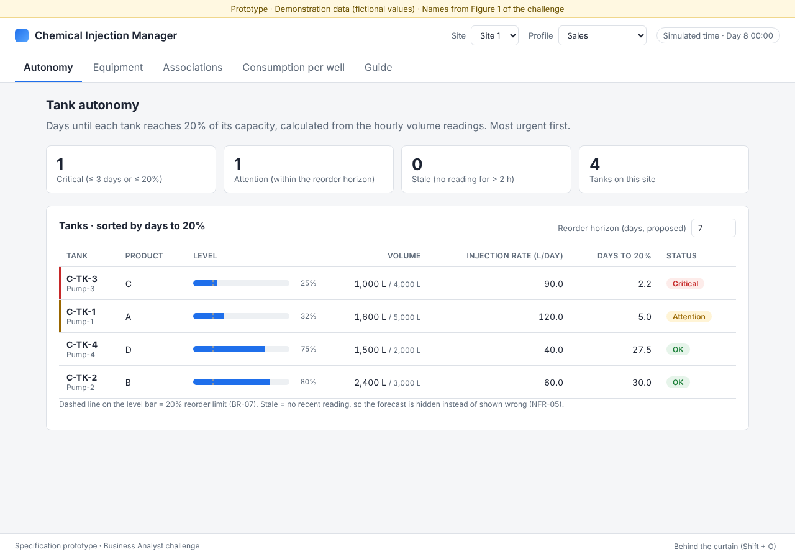
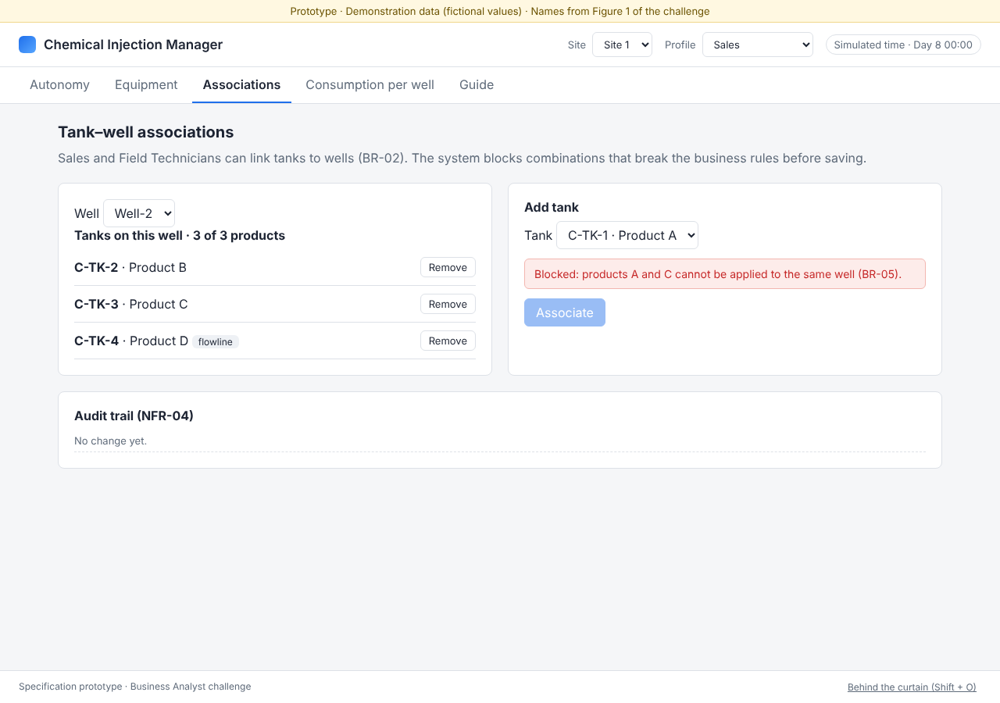
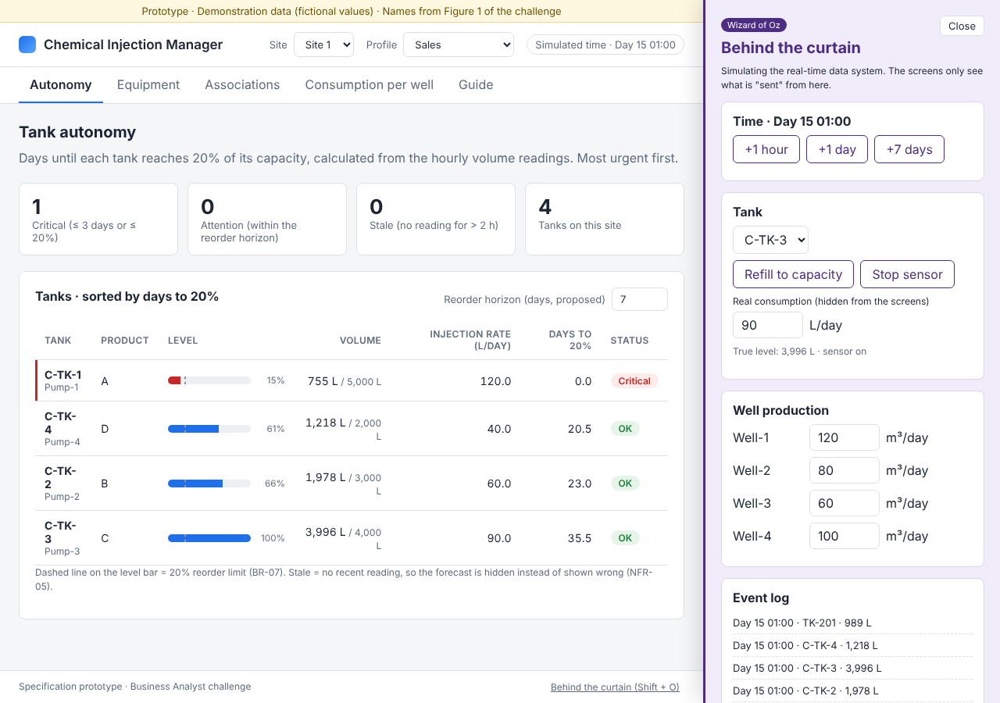

# Chemical Injection Management System – Business Analyst Challenge

Technical task for a Product Owner / Business Analyst selection process: specify a web platform that lets a chemical supplier register tanks and wells per site, associate them under safety rules, and forecast each tank's autonomy so Sales can plan deliveries.

| | Link |
| --- | --- |
| **Working prototype** | https://po-struture-task-desafio-ba.vercel.app/ |
| **Project route board (Miro)** | https://miro.com/app/board/uXjVEPPIUUI=/ |
| **Full specification (PDF)** | [docs/specification/Specification.pdf](docs/specification/Specification.pdf) |
| **Prototype design spec** | [docs/spec/2026-11-12-wizard-of-oz-prototype-design.md](docs/spec/2026-11-12-wizard-of-oz-prototype-design.md) |
| **Implementation plan** | [docs/plan/2026-11-12-wizard-of-oz-prototype.md](docs/plan/2026-11-12-wizard-of-oz-prototype.md) |



## What was done

| Challenge item | Where |
| --- | --- |
| Project deliverables list | Specification, section 5 |
| Project activities by phase (Elicitation, Detailing, + Planning) | Specification, section 6 · Miro board |
| Requirements and business rules | Specification, section 7 (sections 1–4 are the discovery that feeds it) |
| Lo-fi prototype | Specification, section 8 · [docs/specification/lo-fi](docs/specification/lo-fi) |
| Suggested features and KPIs | Specification, section 9 |
| Development methodology and prioritization simulation | Specification, section 10 (MoSCoW, WSJF, release roadmap) |
| Working prototype | This repository, deployed on Vercel |

## Approach

The work follows the order a Product Owner uses on a real project: **understand the problem → define requirements → design → plan delivery**, with a decision gate between phases. Development is planned in Scrum sprints, compatible with SAFe at program level.

1. **Discovery** – problem statement, How Might We, scope in/out, stakeholder map, personas with Jobs-to-be-Done, OKR, assumptions ranked by risk, open questions.
2. **Specification** – deliverables with acceptance criteria, activities per phase, business rules → functional and non-functional requirements → use cases → user stories, Gherkin acceptance criteria.
3. **Design** – lo-fi wireframes, then this working Wizard of Oz prototype.
4. **Planning** – KPIs, suggested features, method choice, MoSCoW, WSJF, release roadmap.

Key choices:

- **Every item is traced to its source:** *Brief* (challenge text), *Diagram* (Figure 1) or *Proposed* (a decision to confirm with the client). Nothing is presented as fact unless it comes from the material provided.
- **The diagram was read critically:** Figure 1 shows Well-1 receiving products A and C, which breaks the rule in the brief, and product D injected into flowlines. Both are open questions and both appear in the prototype.
- **Riskiest assumption first:** consumption per well is estimated, not measured (assumption A1). This drives the roadmap: the MVP delivers the autonomy forecast; consumption per well follows once A1 is validated.
- **Rules are enforced, not just warned:** the brief says the system must not allow them.

## The prototype (Wizard of Oz)

A Wizard of Oz prototype shows a product working before its integrations exist. Here the **screens and business rules are real**; the **external real-time data system is simulated** by a hidden operator panel called *Behind the curtain*.

- Open it with **Shift + O**, the link in the footer, or the URL [`?oz=1`](https://po-struture-task-desafio-ba.vercel.app/?oz=1).
- The panel holds each tank's "real" consumption, but **the screens never read it**: they measure the injection rate from volume readings, exactly as the real system would.
- All numbers are **fictional demonstration data**. Tank, pump, well and product names and the tank–well links of Site 1 come from Figure 1.
- Data lives only in the browser tab; reloading the page resets the demo.

### Demo in 5 steps

1. **Autonomy:** C-TK-3 is *Critical* (≈ 2.2 days to 20%) and C-TK-1 needs *Attention* (5.0 days).
2. **Associations:** pick Well-2 and try to add C-TK-1 (product A). It is blocked: Well-2 already has product C (BR-05).
3. **Profile → Field Technician:** the Equipment tab disappears (BR-01); associations still work (BR-02).
4. **Shift + O → +7 days:** statuses change as volumes fall. Refill C-TK-3 and it returns to *OK*.
5. **Stop sensor** on a tank and advance 3 hours: it turns *Stale* and its forecast is hidden (NFR-05).



### Screens

| Screen | What it does | Requirements |
| --- | --- | --- |
| Autonomy | Tanks sorted by days to 20%, with level, volume, injection rate and status; editable reorder horizon | FR-07, FR-09, FR-10 |
| Equipment | Register tanks and wells with validation; visible only to Sales | FR-01–FR-04, BR-01 |
| Associations | Link and unlink tanks and wells; blocks A + C and a 4th product; audit trail | FR-05, BR-02–BR-05, NFR-04 |
| Consumption per well | Estimated consumption by product and total, chemical per m³, rule check | FR-08 |
| Guide | Rules, field meanings, formulas and panel controls, inside the prototype | — |

### Business rules

| Rule | What it says | Where you see it |
| --- | --- | --- |
| BR-01 | Only Sales registers equipment | Equipment tab hidden for Field Technician |
| BR-02 | Sales and Field Technicians associate tanks to wells | Associations, both profiles |
| BR-03 | A tank feeds many wells; a well receives many products | Associations, Consumption per well |
| BR-04 | Maximum 3 chemical products per well | Associate button disabled, rule message |
| BR-05 | Products A and C never on the same well | Blocked association; Well-1 conflict flagged |
| BR-06 | Equipment belongs to one site; many sites supported | Site selector filters every screen |
| BR-07 | Autonomy is counted until 20% of capacity | Days to 20%, dashed line on the level bar |
| BR-08 | Each tank stores one product and has one pump (Figure 1) | Tank registry |

### Fields and functions

| Field / function | Meaning |
| --- | --- |
| Site | Production site; filters tanks, wells and associations |
| Profile | User role, Sales or Field Technician (simulated login) |
| Simulated time | Clock of the simulation, moved only by *Behind the curtain* |
| Tank ID · Pump | Chemical tank and its dedicated injection pump |
| Product | Chemical stored in the tank (A, B, C or D) |
| Capacity (L) | Maximum volume of the tank |
| Volume (L) · Level | Last hourly reading from the real-time system and its share of capacity |
| Construction material | Basic characteristic of the tank (fictional list) |
| Injection rate (L/day) | Average daily volume drop over the last 7 days, refills excluded |
| Days to 20% | Autonomy: days until the tank reaches the reorder limit |
| Reorder horizon | How many days ahead Sales wants to be warned (proposed, default 7) |
| Production (m³/day) | Individual well production from the real-time system |
| Consumption by product / Total | Estimated chemical each well receives per day |
| Chemical per m³ | Total consumption ÷ production (suggested KPI) |
| Rule check | Flags wells that already break BR-04 or BR-05 |
| Audit trail | Who changed an association, when and what |

**Status:** *Stale* – no reading for more than 2 hours (forecast hidden) · *Critical* – at or below 20%, or ≤ 3 days · *Attention* – within the reorder horizon · *OK* – beyond it. The 2-hour, 3-day and 7-day thresholds are proposed parameters to agree with the client.

**Formulas:**

```
Injection rate (L/day) = volume drop over the last 7 days ÷ days covered   (increases = refills, excluded)
Days to 20%            = (volume − 0.20 × capacity) ÷ injection rate
Well consumption       = Σ tank rate × (well production ÷ production of all wells fed by that tank)
```

### Behind the curtain controls

| Control | Simulates |
| --- | --- |
| +1 hour · +1 day · +7 days | Hourly tank volume readings arriving |
| Refill to capacity | A chemical delivery |
| Stop / Resume sensor | Missing data from one tank (it keeps consuming meanwhile) |
| Real consumption (hidden) | What the tank truly consumes; never read by the screens |
| Well production | Production reported for each well |
| Reset demo | Back to the initial state |



## Repository structure

```
index.html, style.css      Page and visual style
src/data.js                Fictional seed data (Site 1 = Figure 1, Site 2 for the filter)
src/logic.js               Business rules and formulas (pure functions)
src/oz.js                  Behind the curtain: simulated real-time data system
src/app.js                 Screens, profiles, forms, audit trail, guide
tests/                     Unit tests (logic, simulation) and a browser smoke test
docs/specification/        Specification PDF, lo-fi wireframes, release roadmap
docs/spec/, docs/plan/     Prototype design spec and implementation plan
docs/screenshots/          Screens of the working prototype
```

## Run locally

No build and no dependencies. ES modules need a local server:

```bash
python3 -m http.server 8000      # then open http://localhost:8000
npm test                          # unit tests (Node 18+)
npm run smoke                     # browser smoke test (needs Playwright with Chromium)
```

## Out of scope

Real backend or API, persistence across reloads, real authentication, editing or deleting registered equipment, ERP or logistics integration.
